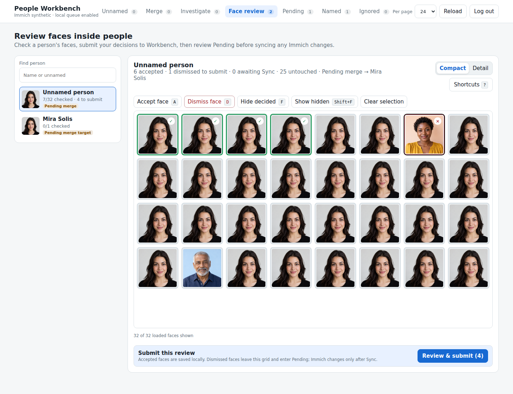
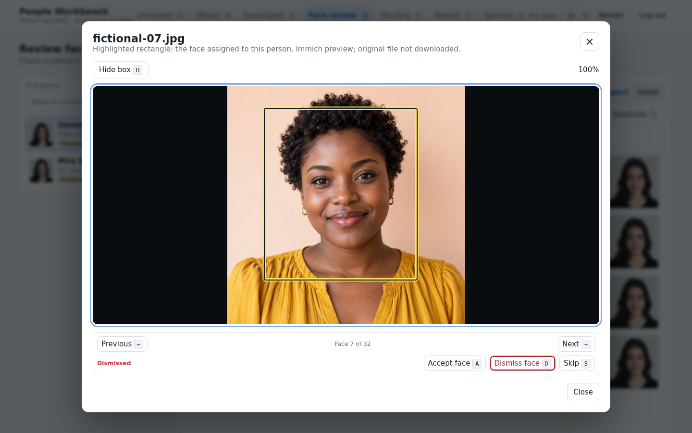
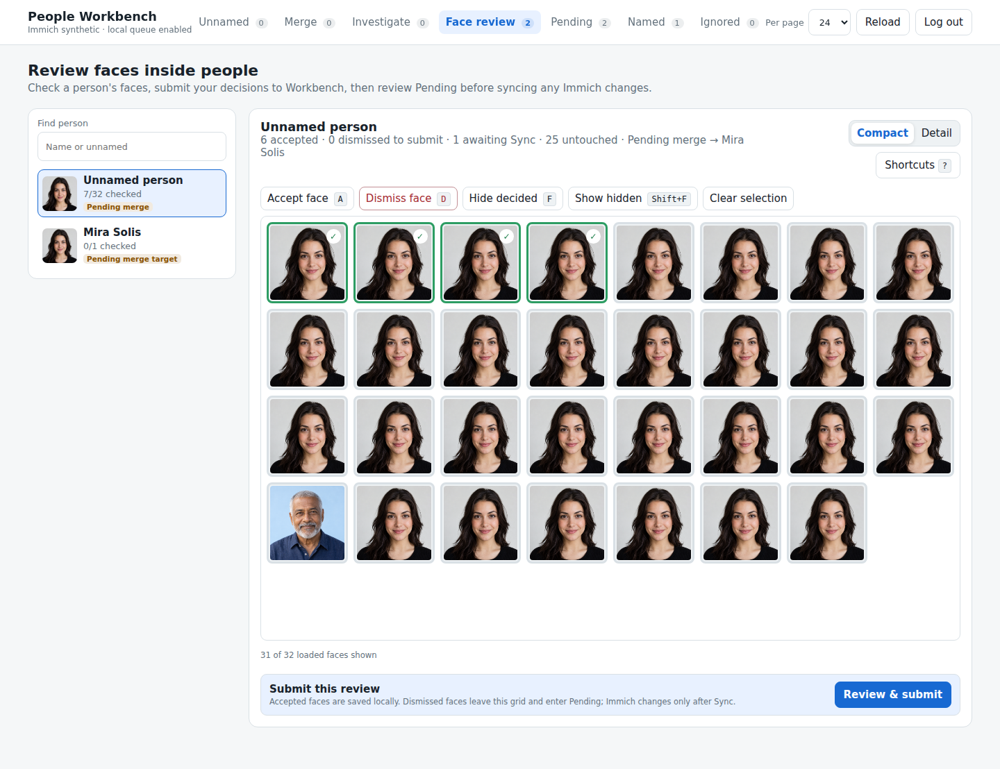

# Face review

[Visual tour](../visual-tour.md) · [User guide](../user-guide.md)

**Face review** checks the faces assigned to a person in Immich. People with
unsynced names or merges remain available here, so you can correct an obvious
mistake before sending the person change to Immich.

Compact mode shows many face crops at once. Use the arrow keys to move focus,
then mark **Accept face** (`A`) or **Dismiss face** (`D`). Press the same key
again to reset that decision. Click, Shift-click, or use Shift+Arrow to select
a group for the same actions. Detail mode gives each crop more room; click
its image, or press `Space` on a focused tile in either mode, to open the photo
with the reviewed face marked by a rectangle. The green and red
borders are local review drafts, saved across reloads; they do not enter Pending
or change Immich yet.

In the photo preview, `A` accepts and `D` dismisses the current face; press
the same key again to reset its decision. The photo stays open. Use Left/Right
to move between visible faces, or `S` to skip ahead without a decision. The
lightbox loads the next page when needed and returns grid focus to the current
face when closed.

In the photo preview, **Hide box** (`H`) removes the rectangle while you inspect
the face. Click the photo to zoom in or return to fit. Use Ctrl+mouse-wheel to
adjust zoom around the pointer, then drag the enlarged photo to pan. The `+`
and `-` keys also adjust zoom; `0` returns to 100%.

Press **Hide decided** (`F`) in the grid to hide the green and red faces marked so far,
including ones loaded on later pages. Marking another face leaves it visible
until you press `F` again, giving you a chance to correct a mistake.
**Show hidden** (`Shift+F`) brings them back.

Choose **Submit review** to confirm the marked faces. Accepted faces remain
green. Dismissed faces leave this person's grid and become face-correction requests
in Pending, where you can inspect, exclude, or remove them. Removing a request
returns its face to Face review.

Only an explicit Pending Sync moves a dismissed face to a new unnamed person in
Immich. When a rename or merge depends on that correction, Sync applies the
face correction first. If it fails or is excluded, the dependent person change
stays in Pending instead of being applied prematurely.

Next: [Pending and Sync](pending.md) to review those requests.
