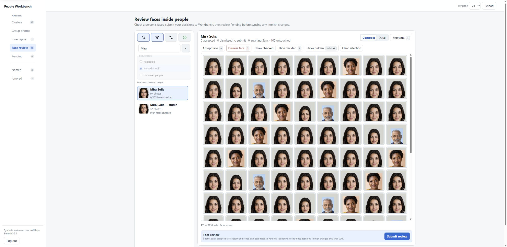
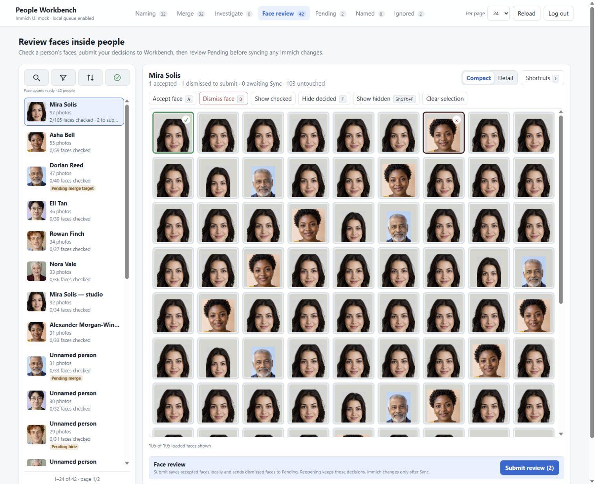
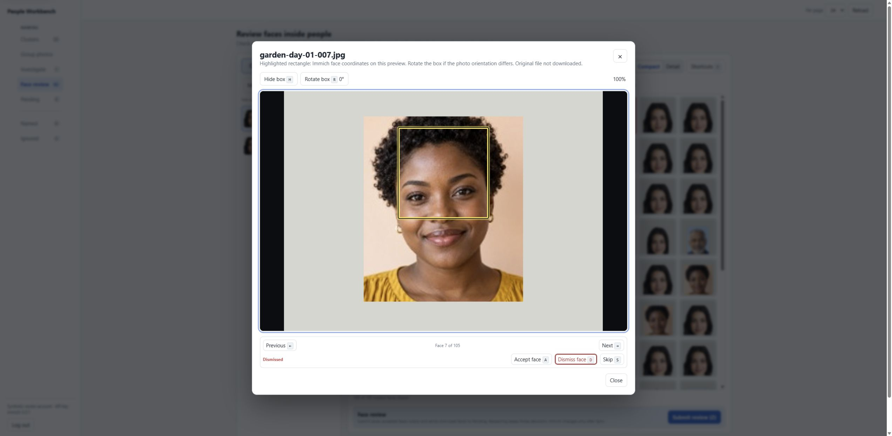
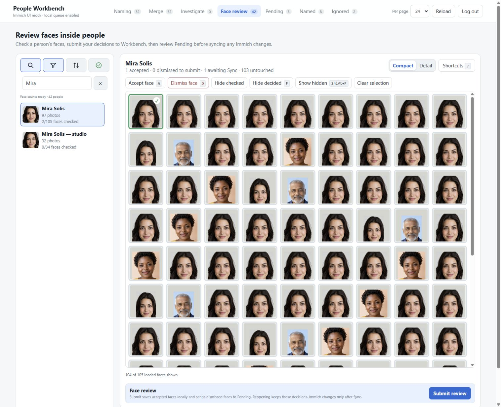

# Face review

[Visual tour](../visual-tour.md) · [User guide](../user-guide.md)

Use **Face review** to check whether the faces assigned to a person really
belong to them. Mark correct faces locally, and separate mistakes through
Pending. A person with an unsynced name or merge can still be reviewed.

## Find the person you want to check

Open **Face review**, then select someone in the left-hand list. The list
scrolls separately from the face grid.

The four compact controls above it help you find your next person:

- **Magnifying glass:** search by name. An active query stays visible; clear
  it before closing the field with the icon or `Escape`.
- **Funnel:** choose All, Named, or Unnamed people. A name only queued in
  Pending still counts as unnamed until Sync.
- **Order:** sort by photo count, update time, or random order.
- **Green check:** hide completed people, or press it again to show them.
  It works independently of the name filter.

The sidebar shows photo counts separately from checked-face progress.
Workbench counts assigned faces in the background. **Counting faces** can
take time on a large library; partial counts survive a restart. **Face counts
ready** means those inventories are available. A photo containing two faces
assigned to this person needs two decisions.

Changing a filter keeps the current person's review open. Filtering the list
does not discard their decisions.

## Mark correct faces and mistakes

**Compact** fits many face crops on screen. **Detail** gives each crop more
space and shows filenames. More faces load as you scroll; **Load more faces**
also lets keyboard users move into the next batch.

Use the arrow keys to focus a tile. Press `A` for **Accept face** or `D`
for **Dismiss face**. Press the same decision again to reset it. Click or
press `Enter` to select a face; Shift-click or Shift+Arrow selects a range
for the same action. Selection has a blue outline.

Here, one face has been accepted and a different fictional person has been
dismissed. Both decisions are still drafts.

Drafts are saved locally across reloads. Wait for saving to finish before
closing the app. They do not enter Pending or change Immich yet.

**Hide decided** (`F`) hides the green and red drafts marked so far. New
decisions stay visible until you press it again. **Show hidden**
(`Shift+F`) brings those faces back. These controls only change the view.

## Inspect a face in its photo

Press `Space` on a focused tile to open the photo preview. In Detail mode,
you can also click the crop. Workbench displays Immich's preview, with a
rectangle around the current face; it does not download the original file.

In the preview:

- Left/Right move between visible faces; `S` skips without deciding.
- `A` or `D` marks the current face and advances. Return with Left and
  press the same decision to undo that marking.
- `R` rotates the rectangle 90° if preview orientation differs; `H`
  hides it. These do not edit Immich's coordinates.
- Click the photo to zoom or return to fit. Ctrl+wheel adjusts zoom; drag
  the enlarged image to pan. `+` / `-` also zoom and `0` returns to 100%.
- `Space` or `Escape` closes the preview and returns focus to its current face.

The lightbox loads the next page when needed. Hidden faces and corrections
already in Pending are outside this sequence.

## Submit the decisions

Choose **Submit review**, or press `Ctrl+Enter` (`⌘+Enter` on macOS).
This takes one action and keeps the person selected.

- Accepted faces become locally checked and are hidden by default. Use
  **Show checked** to inspect them again.
- Dismissed faces leave the person's working grid and become face-correction
  requests in **Pending**.
- Untouched faces remain available to review.

The example now shows **1 awaiting Sync**. The green face is visible because
**Show checked** was enabled; the dismissed face is in Pending.

Open [Pending](pending.md) to inspect, exclude, or remove a correction.
Removing it returns the face to Face review. Only explicit **Sync** moves a
dismissed face into a new unnamed person in Immich.

When a pending name or merge depends on a wrong-face correction, Sync applies
the correction first. A failed or excluded correction leaves the dependent
person change in Pending.

## Finish or reopen a person

Completion is based on distinct assigned faces, not the number of photos.
All photo pages must have been counted, with no untouched or unsubmitted
decisions remaining, before the person can be complete.

**Reopen review** returns a completed person to active review while retaining
accepted faces and Pending requests. **Finish review** completes them again
when their faces have been handled. New photos in Immich can reopen a person.

Use **Shortcuts ?** for the full key reference.

Next: [Pending and Sync](pending.md) to apply reviewed corrections, or
[Group photos](group-photos.md) to identify unnamed clusters with photo context.