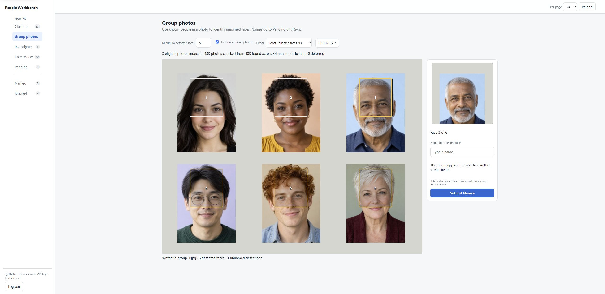
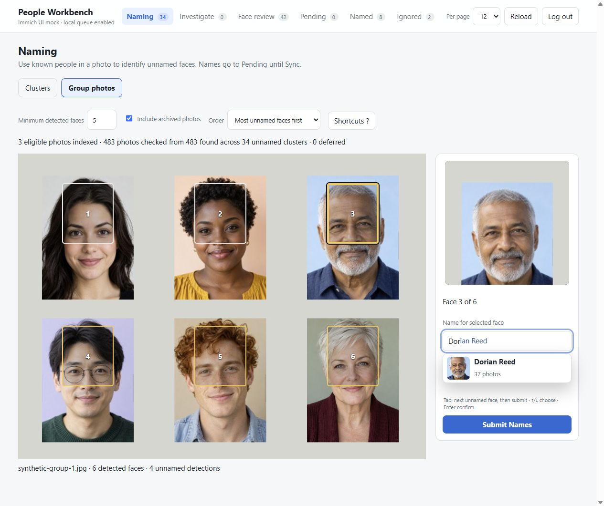
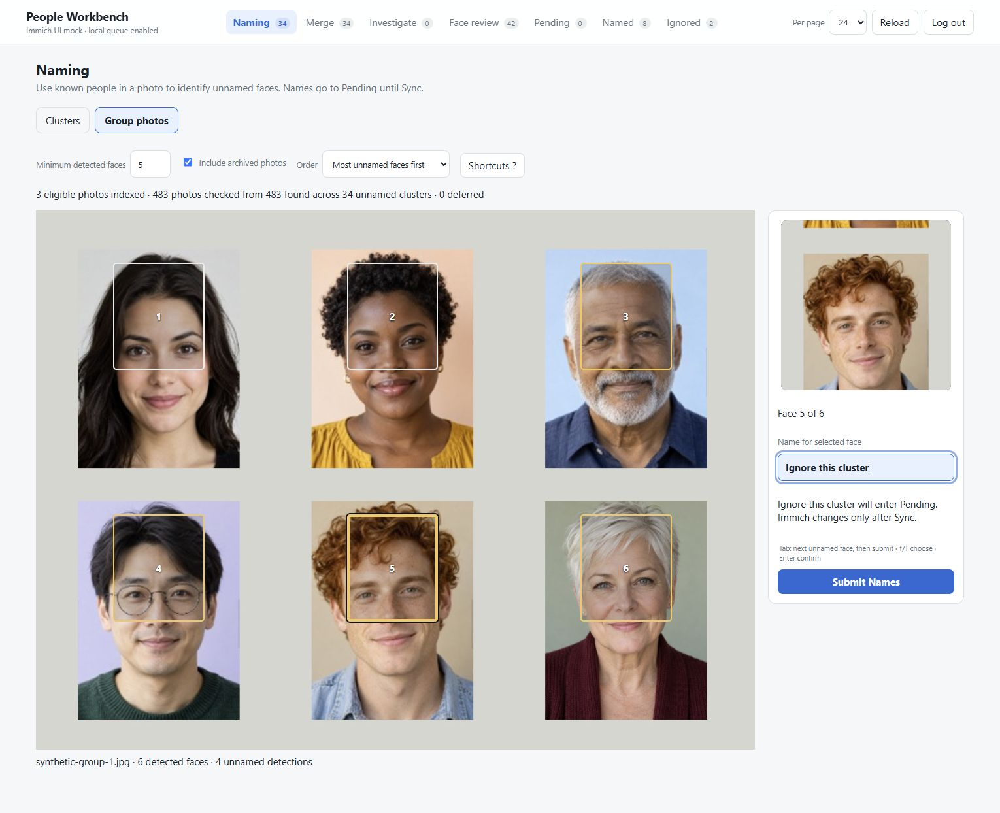
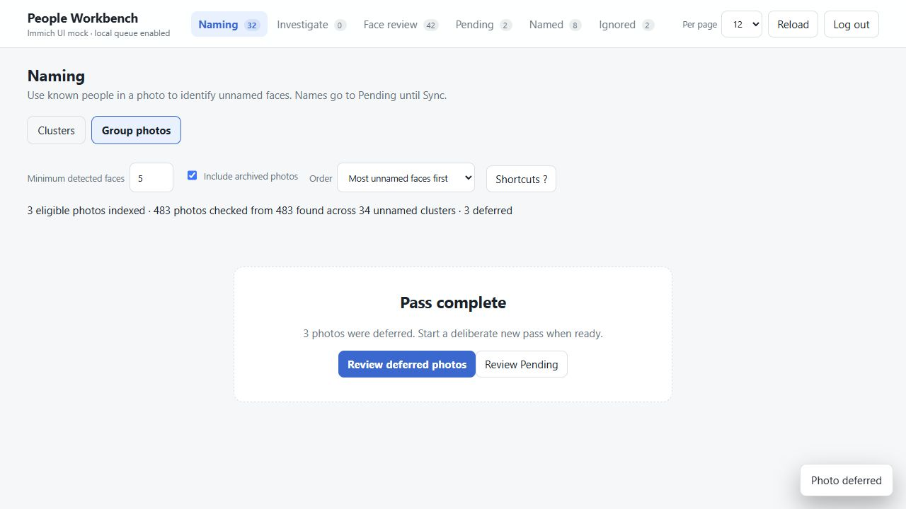

# Group photos

[Visual tour](../visual-tour.md) · [User guide](../user-guide.md)

Open **Naming → Group photos** when knowing someone in a photo might help you
recognize its unnamed faces. Workbench shows the whole photo with numbered
face markers and a name field for the selected cluster.

All examples below use fictional portraits composed into made-up group photos.
The interface is the actual application, running against a local API mock.

## Find a useful photo

The first matching photo appears while Workbench continues searching. By
default it looks for photos with at least **five detected faces**, including
archived photos, linked to visible unnamed clusters. Clusters in
**Investigate** are included too.

Change **Minimum detected faces** to 2 to include smaller groups. Uncheck
**Include archived photos** to leave archived photos out. **Order** sorts by
the number of unnamed detections, update time, or random order.

The progress line distinguishes photos found, checked, and eligible. Workbench
uses faces already detected by Immich; it does not run face detection. A photo
also needs at least one cluster you can currently name.

If nothing appears, read the explanation below the controls. Lower the
minimum, check the archive option, or choose **Retry scan** after failures.
Videos, trashed, hidden, and locked assets are not naming candidates.

## Name the faces you recognize

Click a marker to select it. Named people and names already in **Pending**
provide context; their fields are read-only. An **Unassigned** marker is a
face without a nameable cluster in this view.

`Tab` and `Shift+Tab` cycle through nameable faces and **Submit Names**,
skipping read-only markers. Faces from the same cluster share your entry:
you are naming the cluster, not just this occurrence in the photo.

Type a new name, or choose an existing person from the suggestions. In this
example, `Do` offers **Dorian Reed**, whose face matches the selected cluster.

`Tab` accepts a visible completion; press it again to move on. Up/Down choose
suggestions. `Enter` moves on from a nonempty field; it does not submit the
whole photo.

Choosing an existing person will queue a merge into that person when you
submit. Manually typing an existing full name instead asks whether you intend
a separate person with the same name.

To ignore a cluster, type `ignore` and explicitly choose **Ignore this
cluster**. The field displays that full label so the choice is clear. Merely
typing “Ignore” without choosing the action is treated as a person's name.

Press `H` outside a text field to hide/show the face rectangles. Use
**Shortcuts ?** for the key reference.

## Submit the names you entered

Choose **Submit Names**, or press `Ctrl+Enter` (`⌘+Enter` on macOS).

All entered names, selected merge targets, and ignore actions go to
**Pending** together, then Workbench opens the next photo. Blank faces are
not assigned guesses.

Your current photo, draft names, settings, and pass progress survive reloads
and restarts. Drafts stay local until submission. Submitted operations still
require review and explicit **Sync** on [Pending](pending.md) to change Immich.

## Return to uncertain faces deliberately

Leave a face blank when you are unsure. Submitting the choices you do know
defers that photo for its remaining unnamed faces. Submitting a photo with
no choices defers it without adding Pending operations.

After the initial pass, **Pass complete** shows the deferred count. Choose
**Review deferred photos** when you want another pass. Workbench does not
loop back automatically.

Previously queued names can serve as clues when you return, but those fields
remain read-only. Go to Pending if you need to change or remove a queued
operation.

Next: [Pending and Sync](pending.md) to review the changes, or
[Naming clusters](naming.md) for the faster keyboard naming grid.