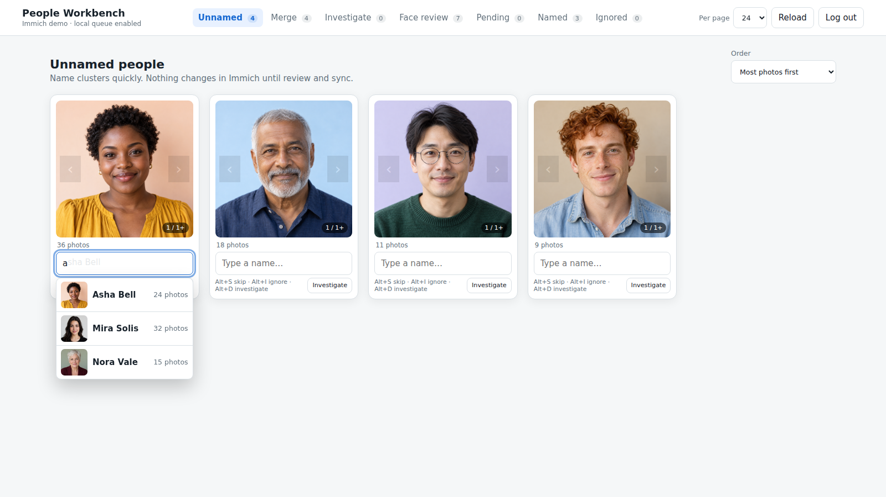
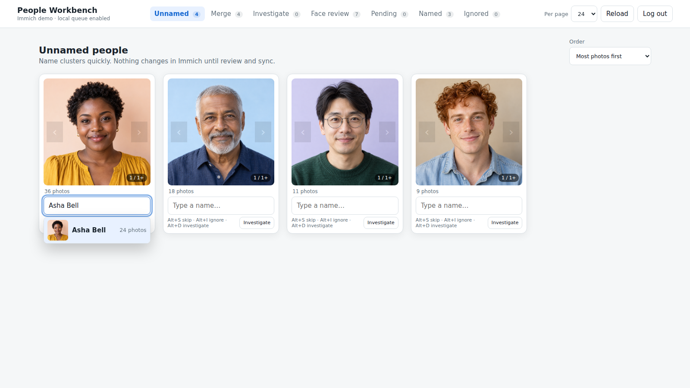

# Naming people

[Visual tour](../visual-tour.md) · [User guide](../user-guide.md)

**Naming → Clusters** lists Immich's visible unnamed face clusters. Each card shows a
representative face and photo count. Use **Order** to change the sequence, and
`Page Up` / `Page Down` to inspect other representative faces. Type a new name
and press `Enter` to put a rename in Pending; focus moves to the next card.

## Reuse an existing person

Typing any part of an existing name opens suggestions with face thumbnails.
Here, `a` matches Asha Bell, Mira Solis, and Nora Vale.

Typing `Ash` narrows the list and shows the rest of **Asha Bell** in grey.
Press `Tab` to accept the completion, or use `Up` / `Down` to choose a
suggestion. Moving above the first suggestion restores your unfinished text.

The chosen target is highlighted. Press `Enter` to queue a merge into that
existing person. This does not write to Immich yet.

If you manually type an existing full name without choosing its suggestion,
Workbench asks whether you really intend to create a *separate* person with
the same name. Use **Back to name** or `Escape` if you meant to merge. Confirm
only when the two people are intentionally different.

## Leave a cluster for later

- `Alt+S` skips it into a later naming round.
- `Alt+D` moves it to [Investigate](investigate.md) for photo context.
- `Alt+I` queues it to be hidden in Immich; review that change in
  [Pending](pending.md).

These actions have different effects: skipping and Investigate only organize
local work; hiding remains a Pending Immich change until Sync.

## Use a group photo for context

Switch to **Group photos** when known faces in the same image can help you name
the unknown ones. It offers a photo, face markers, and one Pending batch per
submission. See [Name faces with Group photos](group-photos.md) for the
step-by-step workflow, settings, shortcuts, and deferred passes.

Next: [Group photos](group-photos.md) for photo context, or
[Pending and Sync](pending.md) to review a queued name.
