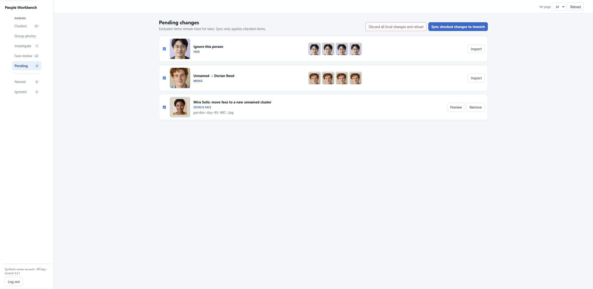
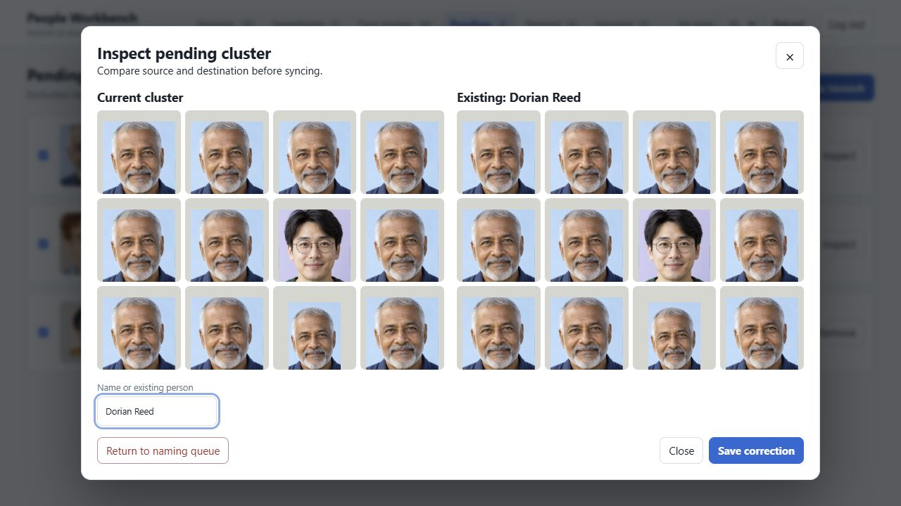

# Pending and Sync

[Visual tour](../visual-tour.md) · [User guide](../user-guide.md)

**Pending** is the review boundary for Immich changes: renames, merges,
hiding or restoring people, and moving a wrong face to a new unnamed cluster.
Queueing an action does not call an Immich write endpoint.

The list shows each proposed change. **Inspect** opens representative faces
for a cluster change; **Preview** opens the photo for a face correction. Checkboxes
decide which items the next Sync includes. Unchecking one leaves it in Pending
for later. **Inspect** lets you review a cluster and correct its queued name
or return it to naming.

Choosing an existing person from name suggestions produces a merge item like
this one. The example uses two synthetic clusters for Dorian Reed.

**Sync checked changes to Immich** is the explicit write step. Review the
checked items first; unchecked items stay queued. If an operation fails,
Workbench keeps it in Pending with an error so you can review and retry it.
The local state directory also keeps Sync reports. The button opens an in-app
confirmation dialog; choose **Sync to Immich** to apply the checked changes
across all Pending pages. **Cancel** or `Esc` closes it without writing. Focus
starts on the confirmation button, so `Enter` confirms; `Tab` lets you choose
Cancel instead.

Sync waits until checkbox selections have been saved. A failed save restores
or reloads the saved selection and shows an error. If the selection cannot be
verified, reload Pending before syncing. If a late save or another tab changes
the queue after review, Sync refuses to start, refreshes Pending, and asks you
to review and explicitly Sync again. The check covers all Pending pages. While
Sync runs, local changes from any tab receive a busy response; wait, then retry
them. Opening Inspect and saving without a correction preserves the existing
operation.

If an error says **Merge completed; representative photo update failed**,
retry Sync to finish that photo update only. This also works after restarting
Workbench. If it says the **merge outcome is uncertain**, first check both
people in Immich. Workbench will not automatically repeat that merge. Remove
the request after reconciling the outcome, and requeue only a change that is
still needed. Removing Pending does not undo an already completed merge.

If a person has face-review corrections waiting in Pending, Sync applies those
before that person's rename or merge. An excluded or failed correction blocks
the dependent person change, which remains available for a later Sync. Review
drafts that have not been submitted also block that change until you submit or
clear them in Face review.

**Discard all local changes and reload** removes unsynced Pending actions
after confirmation. It does not undo changes already synced to Immich or
erase local skip rounds and settings. See [Getting started](../getting-started.md)
for where private local state is stored.

Next: [Named, Ignored, and navigation](named-ignored.md) to see the resulting
views.
